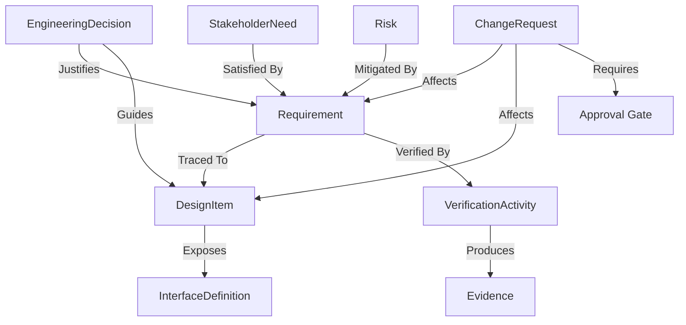

# Domain Model & Traceability

## Core Engineering Entities

The platform records an interconnected digital thread of engineering history across the entire product lifecycle:

| Entity | Purpose |
| :--- | :--- |
| **`Organization`** | Top-level tenant representing the company or institution. |
| **`User`** | System actor with credentials, roles, and membership attribution. |
| **`Project`** | Engineering program/spacecraft/vehicle; all artifacts are strictly scoped here. |
| **`StakeholderNeed`** | Originating operational problem, customer need, or mission objective. |
| **`Requirement`** | Formal technical requirement (statement, rationale, verification criteria, priority, status). |
| **`EngineeringDecision`**| Trade study/decision record capturing rationale, alternatives considered, assumptions, and outcomes. |
| **`DesignItem`** | Physical or logical system element (subsystem, assembly, component, software unit). |
| **`InterfaceDefinition`**| Boundary contract or ICD between two or more design items (electrical, mechanical, data). |
| **`VerificationActivity`**| Verification procedure/test plan with defined method (Test, Analysis, Demonstration, Inspection) and results. |
| **`Risk` & `Issue`** | Risk management register (severity, likelihood, mitigations) and active technical issues. |
| **`ChangeRequest`** | Formal Engineering Change Order (ECO) specifying proposed alterations and affected artifacts. |
| **`Approval`** | Gate sign-off or rejection recorded against change requests or baseline milestones. |
| **`Evidence`** | Supporting artifacts (test reports, CAD links, simulation outputs, compliance sheets). |
| **`AuditLog`** | Immutable append-only log capturing every creation, edit, deletion, or transition. |

---

## Relationship Graph & Traceability

Traceability is preserved in explicit join tables rather than loose metadata tags, enabling direct graph traversal and blast-radius queries:

### Traceability Guarantees

1. **Bidirectional Navigation:** Any engineer can navigate upward from a physical component to its driving requirements and stakeholder needs, or downward from a customer requirement to its verification test results.
2. **Impact Analysis (Blast Radius):** When a `ChangeRequest` or `Requirement` modification is submitted, the system computes the downstream affected nodes (design components, interfaces, verifications) to prevent unintended side-effects.
3. **Verification Readiness:** Automated verification coverage matrices report which requirements lack assigned verification activities or have failing test runs.
